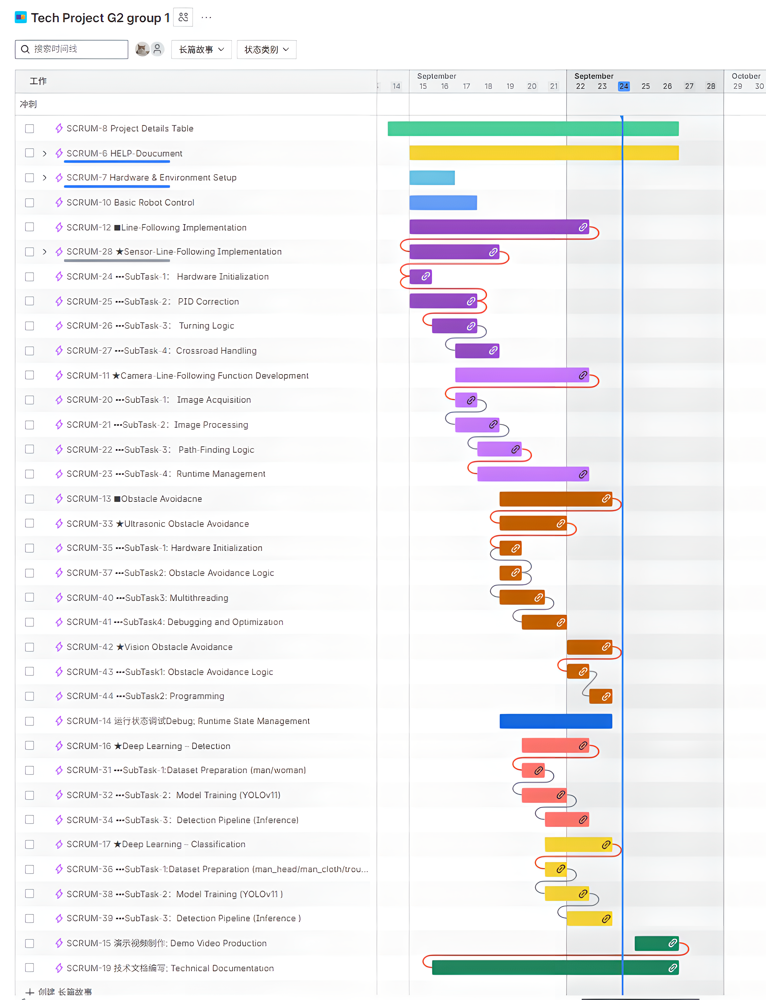

# PiNavLab
### Raspberry Pi Autonomous Navigation & Vision

**A hands-on mobile robotics project combining infrared line tracking, camera-based PID navigation, ultrasonic safety stops, color-based visual triggers, and YOLO object detection.**

**树莓派自主循迹、避障与智能视觉机器人实验平台**

**[English](#english) · [中文](#中文说明) · [Demo Videos](#demo-videos) · [Project Schedule](#project-schedule) · [Full Report](./technical_project_2025_G2_T01.pdf)**

---

## Overview

PiNavLab is a physical Raspberry Pi robot-car project developed for the **2025 Technical Project (Group G2, Team 01)**. Rather than relying on a single perception method, the team implemented and tested **multiple navigation and perception approaches**: lightweight infrared tracking, classical computer vision, ultrasonic ranging, HSV color segmentation, and Ultralytics YOLO.

The repository contains working prototypes, Python source code, labeled training data, model weights, six demonstration videos, a Gantt-style schedule, and a 39-page technical report. Its primary value is the **end-to-end engineering workflow** from real sensors and camera frames to control decisions and motor PWM commands.

> **Scope:** The programs are separate experimental implementations, not a fully integrated sensor-fusion stack or a production autonomous-driving system. “Obstacle avoidance” in these demos means **stop-on-detection**, not geometric path planning around an obstacle. See [Current limitations](#current-limitations).

### At a glance

| Module | Input / perception | Decision & control | Implementation | Demo |
| --- | --- | --- | --- | --- |
| Infrared line following | Four-channel IR line sensors | Weighted discrete error, P control, differential motor PWM, turn recovery | [source](./1.%E2%98%85sensor_line_follow/%E2%98%85sensor_line_follow.py) | [Watch / download](./6.demo_video/1.%E2%98%85sensor_line_follow.mp4) |
| Camera line following | MJPG camera feed, OpenCV | Six-strip centroids, curvature classification, PID, sharp-turn state machine | [source](./2.%E2%98%85Camera-Line%E2%80%90Following/%E2%98%85Camera-Line%E2%80%90Following.py) | [Watch / download](./6.demo_video/2.%E2%98%85Camera-Line%E2%80%90Following.mp4) |
| Ultrasonic safety stop | Ultrasonic echo timing | Averaged distance, independent monitoring thread, shared stop flag | [source](./3.%E2%98%85Ultrasonic%20Obstacle%20Avoidance/%E2%98%85Ultrasonic%20Obstacle%20Avoidance.py) | [Watch / download](./6.demo_video/3.%E2%98%85SensorUltrasonic%20Obstacle%20Avoidance.mp4) |
| Vision-triggered stop | RGB camera frames | HSV masks for red/yellow/blue; stop when target-color area exceeds threshold | [source](./4.%E2%98%85Vision%20Obstacle%20Avoidance/%E2%98%85Vision%20Obstacle%20Avoidance.py) | [Watch / download](./6.demo_video/4.%E2%98%85Vision%20Obstacle%20Avoidance.mp4) |
| YOLO object detection | Annotated images & camera feed | Two-class and five-class object detection, bounding boxes, FPS display | [source](./5.%E2%98%85Deep%20Learning/Classficatiom/Predict/predict.py) / [source](./5.%E2%98%85Deep%20Learning/Detection%28man_woman%29/Predict/predict.py) | [Watch / download](./6.demo_video/5.%E2%98%85Deep%20Learning-Detection%28man_woman%29.mp4) / [Watch / download](./6.demo_video/6.%E2%98%85Deep%20Learning%20%E2%80%93%20Classfication%28%28man_headman_clothtrouserswoman_headwoman_dress%29%29.mp4) |

## System architecture

The navigation tracks below represent **alternative experiments** that share the Raspberry Pi / GPIO motor-control platform, not components simultaneously fused into a single controller.

~~~mermaid
flowchart TD
    A["Raspberry Pi robot car"] --> B{"Select experiment"}
    B --> C["4-channel infrared sensors"]
    B --> D["Camera / MJPG stream"]
    C --> E["Line pattern + discrete error"]
    E --> F["P controller / turn recovery"]
    D --> G["OpenCV grayscale + Gaussian blur + Otsu"]
    G --> H["6-strip line centroids + curvature"]
    H --> I["PID / big-turn state machine"]
    F --> J["GPIO motor commands + PWM"]
    I --> J
    A --> K["Ultrasonic sensor"]
    K --> L["Range averaging + safety stop thread"]
    L --> J
    D --> M["HSV target-color area detection"]
    M --> N["Emergency stop"]
    N --> J
    D --> O["Ultralytics YOLO inference demo"]
    O --> P["Bounding boxes + labels + FPS / recording"]
~~~

<b>Control pipeline in one sentence</b>

Sensor/video acquisition → thresholding or pattern recognition → lateral error / obstacle condition → proportional/PID or stop decision → GPIO direction pins and PWM motor duty cycles.

## Hardware

The team modified a four-wheel robot chassis, placed the camera toward the front for a clearer field of view, and used the Raspberry Pi to interface with the sensors and motor driver. See the **labeled hardware photograph on page 3** of the [technical report](./technical_project_2025_G2_T01.pdf#page=3).

| Component | Role |
| --- | --- |
| Raspberry Pi | Python execution, GPIO control, video acquisition |
| Four-channel infrared tracking sensors | Binary black-line / white-background readings |
| Ultrasonic range sensor | Front-facing obstacle-distance estimation |
| Front-mounted camera | Line geometry, target-color cues, and YOLO video input |
| DC motors + motor driver | Differential-speed steering and stop/spin actions |
| Battery / power wiring | Power for the embedded platform and actuators |

**GPIO configuration (BCM numbering, as committed):**

| Interface | BCM pins |
| --- | --- |
| Motor direction | IN1=20, IN2=21, IN3=19, IN4=26 |
| Motor PWM enable | ENA=16, ENB=13 |
| Line sensors, left → right | 3, 5, 4, 18 |
| Ultrasonic | TRIG=1, ECHO=0 |
| Start button (sensor-only version) | 8 |

> Check the exact motor-driver voltage, common ground, pin numbering, and ultrasonic echo voltage before connecting the hardware. BCM numbering is **not** physical header-pin numbering.

## How it works

### 1. Infrared line following — proportional steering

Four reflectance sensors read a digital pattern, with **0 = black line** and **1 = white background**. The outer sensors primarily identify sharp turns while the inner pair drives normal steering correction. The current script uses a proportional controller (not a full PID controller):

~~~text
correction  = Kp × error
left_speed  = clamp(base_speed + correction, 0, 100)
right_speed = clamp(base_speed - correction, 0, 100)
~~~

For the standalone script, the configured values are <code>base_speed = 25</code>, <code>Kp = 15</code>, and <code>PWM = 2000 Hz</code>.

| Sensor condition | Behavior |
| --- | --- |
| Inner sensors indicate lateral deviation | Adjust left/right motor duty cycles proportionally |
| Two left sensors detect black | Execute sharp left turn |
| Two right sensors detect black | Execute sharp right turn |
| All sensors detect black | Drive forward briefly across the intersection / wide black region |
| All sensors detect white | Search toward the last nonzero error direction |

This is a compact example of **closed-loop mobile-robot control** using low-cost digital sensors and differential-drive steering.

### 2. Camera line following — classical CV + PID + state machine

The camera implementation does not require a deep neural network to identify the track. It processes frames using:

1. **Preprocessing:** BGR → grayscale → 5×5 Gaussian blur → Otsu inverse binary threshold.
2. **Multi-strip analysis:** split the image into **six horizontal strips**, calculate the mean x-coordinate of line pixels in each valid strip, and connect valid centroids.
3. **Geometry estimation:** use consecutive centroid vectors, maximum local angle, and lateral displacement to estimate turn direction and sharpness.
4. **Motion logic:** use <code>PID_FOLLOW</code> on ordinary sections and <code>BIG_TURN_EXECUTE</code> for sharp turns, with separate left/right rotation commands.
5. **Recovery / validation:** evaluate centroid distribution and the mode exit condition on subsequent frames.

The checked-in script uses **64×48 processing frames**, <code>KP=1.2</code>, <code>KI=0.02</code>, <code>KD=0.01</code>, and six strips. Large-turn classification uses approximately **35° local angle or 0.5 normalized lateral displacement** as its principal trigger.

**Why a state machine?** PID handles small tracking errors effectively, but sharp/right-angle bends can require a dedicated turn maneuver before returning to normal tracking. The project report documents six iterations of this logic, ending with improved right-angle recognition.

### 3. Ultrasonic obstacle detection — concurrent control

The ultrasonic prototype runs a tracking thread and an obstacle-monitoring thread. The latter gathers **15 valid distance measurements** and averages them to reduce spurious readings. A distance in the range **0–30 cm** triggers motor braking and a shared obstacle flag. Motor functions are guarded by a <code>threading.Lock</code> to serialize GPIO updates.

The current implementation prompts for the user to enter **q + Enter** before clearing the obstacle flag. **Important:** its tracking thread currently executes <code>break</code> when the flag is set; therefore, the report's intended automatic resumption is **not fully realized by the committed version**. The report's four-version experiment log illustrates the evolution from blocking ultrasonic reads to threaded monitoring and averaging.

### 4. Vision-triggered stopping — HSV color segmentation

This experiment adds a lightweight high-priority visual trigger to the camera line-following program. OpenCV converts a frame to HSV and combines color masks for **red, yellow, and blue**. When the union of matching pixels exceeds **2% of the frame**, the vehicle brakes and terminates that run.

This is **color-based object / marker detection**, not a generic pedestrian detector. It demonstrates a simple camera-based safety trigger while keeping the algorithm interpretable.

### 5. YOLO detection — dataset, training, inference

The deep-learning experiments use **Roboflow-annotated datasets** and **Ultralytics YOLO** with two detection granularities:

| Experiment | Labels | Use |
| --- | --- | --- |
| Two-class detector | <code>man</code>, <code>woman</code> | Coarse target detection |
| Five-class detector | <code>man cloth</code>, <code>man head</code>, <code>trousers</code>, <code>woman dress</code>, <code>woman head</code> | Fine-grained bounding-box detection |

**Dataset workflow:** camera capture → Roboflow upload → bounding-box annotation → resizing / augmentation → YOLO-format export → model training → validation → live camera inference. The five-class dataset includes <code>train/</code>, <code>valid/</code>, <code>test/</code> splits, labels, and a <code>data.yaml</code> file.

**Inference workflow:** MJPG HTTP stream (fallback to local webcam in prediction scripts) → load model → predict → draw boxes and class/confidence labels → display smoothed FPS → optionally record annotated video.

The report calls this section “Detection & Classification.” In implementation, **both configurations produce object-detection boxes**, rather than a separate image-classification pipeline. The report refers to YOLO11, while the committed five-class training script initializes <code>yolov8n.pt</code>; refer to the code and checkpoint metadata before claiming a particular model architecture.

**Examples from the repository's five-class test dataset:**

  
  &nbsp;
  

These are dataset samples, not claimed prediction screenshots. For inference results, watch the two YOLO videos below and consult pages 35–38 of the report.

## Demo videos

Each video is stored in the repository; click to view it on GitHub or download the original MP4. These demonstrations are independent task recordings.

| # | Demonstration | Video |
| --- | --- | --- |
| 01 | Infrared sensor line tracking | [Watch / download](./6.demo_video/1.%E2%98%85sensor_line_follow.mp4) |
| 02 | Camera-based line tracking | [Watch / download](./6.demo_video/2.%E2%98%85Camera-Line%E2%80%90Following.mp4) |
| 03 | Ultrasonic detection and safety stop | [Watch / download](./6.demo_video/3.%E2%98%85SensorUltrasonic%20Obstacle%20Avoidance.mp4) |
| 04 | HSV vision-triggered stop | [Watch / download](./6.demo_video/4.%E2%98%85Vision%20Obstacle%20Avoidance.mp4) |
| 05 | YOLO two-class detection (man / woman) | [Watch / download](./6.demo_video/5.%E2%98%85Deep%20Learning-Detection%28man_woman%29.mp4) |
| 06 | YOLO five-class detection | [Watch / download](./6.demo_video/6.%E2%98%85Deep%20Learning%20%E2%80%93%20Classfication%28%28man_headman_clothtrouserswoman_headwoman_dress%29%29.mp4) |

**All demonstrations:** [browse the video directory](./6.demo_video/).

## Experimental results

The following values are **reported in the September 2025 PDF**, not independently re-benchmarked from the repository. They should be interpreted as the team's reported experiments, not as a hardware deployment benchmark.

| Experiment | mAP@0.5 | mAP@0.5:0.95 | Other information |
| --- | ---: | ---: | --- |
| Two-class YOLO detector | ≈0.95 | ≈0.82 | Reported precision ≈0.93, recall ≈0.90 |
| Five-class YOLO detector | Report gives ≈0.80–0.90* | ≈0.75 | Reported precision ≈0.88, recall ≈0.85 |

*The five-class mAP@0.5 is inconsistent across the report (≈0.90 on p.35; ≈0.80 on p.38). Please refer to the original evaluation artifacts before presenting a single definitive value.*

The report also documents **four iterations** of ultrasonic sensing and **six iterations** of camera-turn logic. These are qualitative development records, not controlled comparative benchmarks.

## Project schedule

The original **Gantt chart** documents task planning, parallel implementation, integration, and project-delivery milestones.

[Open original schedule image](./schedule/schedule.png) · [Read full technical report (39 pages)](./technical_project_2025_G2_T01.pdf)

## Repository structure

The source tree intentionally retains its original team-project directory and file names, including special characters and historical spelling. Links above point to the checked-in paths.

~~~text
technical_project_2025_G2_T01/
├── 1.★sensor_line_follow/
│   └── ★sensor_line_follow.py
├── 2.★Camera-Line‐Following/
│   └── ★Camera-Line‐Following.py
├── 3.★Ultrasonic Obstacle Avoidance/
│   └── ★Ultrasonic Obstacle Avoidance.py
├── 4.★Vision Obstacle Avoidance/
│   └── ★Vision Obstacle Avoidance.py
├── 5.★Deep Learning/
│   ├── Classficatiom/
│   │   ├── Predict/predict.py
│   │   ├── datasetPreparation/Dataset/
│   │   └── trainModel/
│   └── Detection(man_woman)/
│       ├── Predict/predict.py
│       └── trainModel/
├── 6.demo_video/
│   └── [six MP4 demonstrations]
├── schedule/
│   └── schedule.png
├── technical_project_2025_G2_T01.pdf
└── README.md
~~~

## Getting started

### Prerequisites

- Raspberry Pi with a compatible Python / <code>RPi.GPIO</code> environment, motor driver, correctly wired sensors, and motor power.
- For vision experiments: a working camera video feed and OpenCV / NumPy.
- For the detection experiments: Ultralytics, PyTorch, trained weights, and a supported inference device (CPU or CUDA).
- If using the existing hard-coded network settings, a reachable **MJPG-Streamer** endpoint at <code>http://192.168.50.1:8080/?action=stream</code>.

~~~bash
git clone https://github.com/shiyi-ale/technical_project_2025_G2_T01.git
cd technical_project_2025_G2_T01

# Python packages (install in an appropriate environment)
python3 -m pip install numpy opencv-python ultralytics

# On a configured Raspberry Pi with appropriate GPIO permissions:
python3 "1.★sensor_line_follow/★sensor_line_follow.py"

# Camera-based line following:
python3 "2.★Camera-Line‐Following/★Camera-Line‐Following.py"

# Ultrasonic line following and safety stop:
python3 "3.★Ultrasonic Obstacle Avoidance/★Ultrasonic Obstacle Avoidance.py"

# HSV vision-triggered stop:
python3 "4.★Vision Obstacle Avoidance/★Vision Obstacle Avoidance.py"
~~~

**Important setup notes**

1. <code>RPi.GPIO</code> is hardware-specific; the motor-control scripts cannot drive motors on an ordinary desktop without substituting or mocking the GPIO layer.
2. Confirm <code>STREAM_URL</code>, <code>SHOW_VIDEO</code>, hardware pins, and controller parameters before starting. Graphical OpenCV display may be unsuitable for headless SSH sessions.
3. The two <code>Predict/predict.py</code> files contain **Windows absolute model paths**; edit <code>model_path</code> to a weight file in the repository before running.
4. The current prediction loops pass <code>device='cuda:0'</code> to inference even when CPU is selected earlier. Change that argument to the computed <code>device</code> value for CPU execution.
5. The original training script also contains machine-specific dataset paths and model configuration. It is a recorded experiment rather than a one-command portable training recipe.
6. Start at low motor speed with wheels elevated during first tests, and verify the stop function before placing the car on a course.

## Current limitations

- **No unified fusion controller:** infrared and camera navigation are separate trials, not a dynamically switched or fused perception stack.
- **Line-loss handling:** the camera script currently has its brake / PID reset calls commented out in the line-loss branch; do not assume fail-safe stopping.
- **Obstacle recovery:** the ultrasonic tracking thread currently exits on an obstacle flag instead of suspending and reliably resuming.
- **Ultrasonic robustness:** valid-sample acquisition has no upper bound on total retries if distance readings remain invalid.
- **Portable model execution:** paths, training configs, and CUDA inference selection require cleanup for cross-platform reproduction.
- **Reproducibility:** the report lists approximate evaluation metrics, but complete experiment metadata, exact dependency lockfiles, and hardware timing benchmarks are not yet provided.

These make useful starting points for contributions: safer arbitration between concurrent motor commands, parameterized configuration, testable PID/state-machine modules, robust sensor timeouts, and reproducible YOLO evaluation.

## Team & references

Developed as **Technical Project — G2 / Team 01 (September 2025)** by **Zhao Hangjian, Zhou Hangyu, and Jia Zihan**.

- [Full 39-page project report](./technical_project_2025_G2_T01.pdf) — hardware image, control logic diagrams, method explanations, iteration tables, YOLO workflow, and results.
- [Project Gantt chart](./schedule/schedule.png).
- [OpenCV](https://opencv.org/) · [Ultralytics](https://docs.ultralytics.com/) · [Roboflow](https://roboflow.com/).

**Licensing:** The root repository currently does not include a <code>LICENSE</code> file. The five-class dataset metadata states <code>CC BY 4.0</code> for that dataset; this should not be assumed to license all project code and media.

---

## 中文说明

### 项目介绍

**PiNavLab** 是一个以树莓派四轮小车为载体的机器人综合实践项目，目标是完成从**环境感知 → 路径判断 → 控制决策 → 电机执行 → 测试迭代**的完整工程开发流程。项目不是把所有传感器直接融合在一起，而是分别实现、验证了传统传感器方案、OpenCV 视觉方案及 YOLO 深度学习方案。

项目仓库提供：**4 套底盘控制程序、2 套 YOLO 推理程序、目标检测数据集及模型、6 段实车/推理演示视频、项目计划甘特图和 39 页技术报告**。

### 五大核心模块

| 模块 | 技术实现 | 工程价值 |
| --- | --- | --- |
| **红外循迹** | 四路红外黑白线检测、离散偏差估计、P 比例控制、差速 PWM、急转弯及丢线方向记忆 | GPIO、传感器接线、闭环控制、移动机器人基础 |
| **摄像头循迹** | 灰度化、5×5 高斯滤波、Otsu 二值化、6 条带质心提取、局部角度判断、PID + 大弯状态机 | OpenCV、图像几何、实时状态机、参数调试 |
| **超声波避障** | 超声波测距、15 次有效数据均值、30 cm 阈值、多线程、锁保护电机接口、停车确认 | 并发控制、实时响应、安全优先级与问题定位 |
| **视觉触发停车** | HSV 颜色空间、红黄蓝颜色掩膜、目标像素比例超过 2% 触发停车 | 轻量级视觉感知、事件检测、系统联动 |
| **YOLO 目标检测** | Roboflow 标注/增强、2 类及 5 类检测模型、摄像头视频流推理、目标框和 FPS 可视化 | 数据集构建、模型训练、部署调试与性能评估 |

### 关键技术细节

**1. 传感器循迹：** 四路红外分别输出 0（黑线）或 1（白底），软件根据组合得到车身横向误差，再用 <code>Kp × error</code> 调整左右电机的 PWM 占空比。对十字路口、急左转、急右转和完全丢线分别设计专用动作。

**2. 视觉循迹：** 将摄像头画面二值化后均分为 6 个水平条带，计算各条带中的黑线质心，按近到远分析路径走向。普通路段采用 PID 差速控制，急弯切换到 <code>BIG_TURN_EXECUTE</code> 模式，并利用连续质心的方向关系判断退出时机。当前代码分辨率为 **64×48**，与报告中的 **128×96** 描述不同，应以源码为准。

**3. 超声波监测：** 障碍物监测线程与循迹线程并发运行，电机操作受锁保护；前方有效测距低于 **30 cm** 时停车并等待人工确认。注意仓库当前版本中，循迹线程收到障碍物标志后会退出，因此还需要修正才能实现可靠的“清障后继续”。

**4. 颜色识别：** 对红色、黄色、蓝色区域进行 HSV 阈值分割。当目标颜色占整帧比例超过 **2%** 时停车。该实现识别的是**颜色特征**，并不能泛化为任意行人的语义识别。

**5. YOLO 检测：** 一组模型识别 <code>man/woman</code>；另一组模型识别上衣、头部、裤子、裙装等五个细分类别，使用 Roboflow 数据集及 Ultralytics 推理接口。项目报告记录的两类检测模型 **mAP@0.5≈0.95、mAP@0.5:0.95≈0.82**。这些数值来自报告，不应等同于当前硬件上的实时推理性能；五类模型的 mAP@0.5 在报告不同页不一致，需进一步核对日志。

### 开发过程与项目亮点

- **完整软硬件链路：** 传感器、摄像头、树莓派 GPIO、电机驱动和车载执行机构共同构成一个可运行的实物系统。
- **算法对比而非单纯堆叠：** 同一条巡线任务分别采用低成本红外传感器方案和经典视觉方案，实现思路与成本不同。
- **有记录的问题迭代：** 技术报告保留超声波模块 **4 次迭代**、视觉转弯逻辑 **6 次迭代**，包括延迟、误判、转弯方向和退出条件的分析。
- **计算机视觉到深度学习：** 从 Otsu/HSV 等可解释方法，延伸到数据标注、目标检测模型训练及视频流推理。
- **可用于机器人/创客课程：** GPIO、PWM、差速驱动、控制算法、OpenCV、Python 多线程和 YOLO 实验均有对应源码及演示材料。

### 演示与资料

- [红外循迹视频](./6.demo_video/1.%E2%98%85sensor_line_follow.mp4) · [摄像头循迹视频](./6.demo_video/2.%E2%98%85Camera-Line%E2%80%90Following.mp4) · [超声波避障视频](./6.demo_video/3.%E2%98%85SensorUltrasonic%20Obstacle%20Avoidance.mp4)
- [视觉停车视频](./6.demo_video/4.%E2%98%85Vision%20Obstacle%20Avoidance.mp4) · [两类 YOLO 检测视频](./6.demo_video/5.%E2%98%85Deep%20Learning-Detection%28man_woman%29.mp4) · [五类 YOLO 检测视频](./6.demo_video/6.%E2%98%85Deep%20Learning%20%E2%80%93%20Classfication%28%28man_headman_clothtrouserswoman_headwoman_dress%29%29.mp4)
- [项目进度甘特图](./schedule/schedule.png) · [完整 PDF 技术报告](./technical_project_2025_G2_T01.pdf)

### 复现前须知

本仓库保留了课程项目时期的实验性代码。部分程序依赖固定的树莓派接线、MJPG 视频流地址和 Windows 模型路径，CUDA 推理设备也有硬编码。首次运行请先检查接线与供电，在悬空车轮及低速条件下调试。**代码可用于学习和进一步开发，但暂不能视为一键部署、完整恢复机制已经验证的工业级项目。**

---

**Built to learn, test, and improve real-world robot perception and control.**

[Back to top](#pinavlab)

